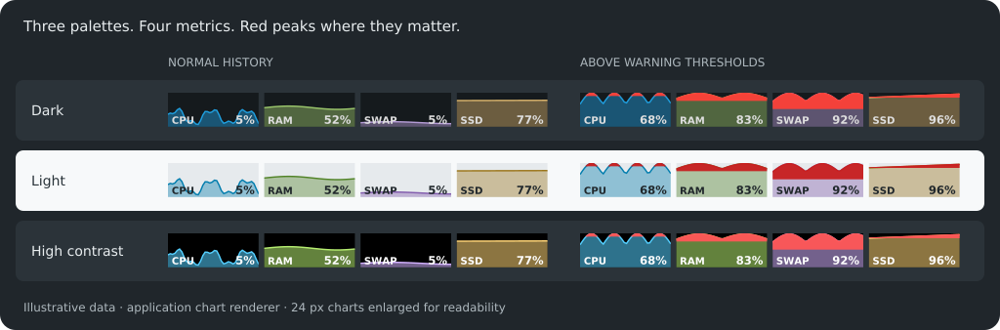

# Mint Pulse

[](https://github.com/SamZaitcev/mint-pulse/actions/workflows/ci.yml)
[](LICENSE)
[](Cargo.toml)

**Four small graphs, right beside your clock.**

Mint Pulse is a lightweight Rust system tray indicator for **Linux Mint Cinnamon**.
It displays CPU load, RAM usage, swap usage and filesystem occupancy in one wide XApp tray icon,
with a new sample every **2 seconds** and approximately **80 seconds of history**.



*Illustrative histories drawn with the application's chart renderer. Charts are enlarged for readability.*

## What it does

- Keeps metric names and percentages inside the graphs, leaving the full icon height for the history.
- Colors only the part of a graph above its warning threshold red, while preserving the metric's base color below it.
- Provides dark, light and high-contrast palettes, with automatic selection from the desktop theme name.
- Follows the tray's requested icon height and prevents a second launch from creating a duplicate indicator.
- Shows a dash for unavailable readings and disabled swap, with totals and free space available in the tooltip.

The indicator runs as a separate process. Its history is bounded to 40 samples, it starts no external commands
for each update, and its two alternating PNG frames live in a private directory under `/dev/shm`.
There are **no third-party Cargo dependencies**; rendering and desktop integration use the native Cairo,
GTK 3, GLib/GIO and XApp libraries already used by Cinnamon.

## Install a DEB build

Prebuilt CI packages are available for **amd64 / x86_64**.

1. Open [GitHub Actions](https://github.com/SamZaitcev/mint-pulse/actions/workflows/ci.yml)
   and select a successful run for `main`.
2. Download **`mint-pulse-deb-amd64`** from the run's **Artifacts** section and extract the ZIP.
3. Open a terminal in the extracted directory:

```sh
sha256sum --check SHA256SUMS
sudo apt install ./mint-pulse_*_amd64.deb
/usr/bin/mint-pulse
```

You can also start **Mint Pulse** from the application menu.
Run it inside your graphical Cinnamon session, with the **XApp Status Applet** enabled on a top or bottom panel.
To add the applet, right-click the panel, open **Applets**, and add **XApp Status Applet**.

GitHub requires a signed-in account to [download workflow artifacts](https://docs.github.com/en/actions/how-tos/manage-workflow-runs/download-workflow-artifacts).
This project's artifacts are kept for **7 days**. If a build has expired, use a newer successful run
or [build from source](#build-from-source). The current workflow publishes build artifacts rather than GitHub Releases.

### Start at login

Open Cinnamon's **Startup Applications**, add a custom entry, and use this command:

```sh
/usr/bin/mint-pulse
```

To keep custom options at login, put them in that same startup command:

```sh
/usr/bin/mint-pulse --theme dark --thresholds 90,75,50,85 --path /
```

The package leaves startup preferences under your control. If you used an earlier manual installation,
review entries pointing to `~/.local/bin/mint-pulse` and switch the startup command to `/usr/bin/mint-pulse`.
Stop the older process before starting the packaged version.

### Uninstall

Stop the running indicator, remove its Startup Applications entry if you added one, then run:

```sh
sudo apt remove mint-pulse
```

## Configure the graphs

Settings are command-line options. For example:

```sh
/usr/bin/mint-pulse --theme light --thresholds 90,70,50,85 --path /
```

This selects the light palette, turns RAM peaks red above 70%, and monitors the root filesystem.
The other thresholds remain CPU 90%, swap 50% and filesystem occupancy 85%.

| Option | Default | Purpose |
| --- | --- | --- |
| `--theme MODE` | `auto` | Select `auto`, `dark`, `light` or `high-contrast`. |
| `--thresholds CPU,RAM,SWAP,SSD` | `90,75,50,85` | Set a separate warning threshold for each metric. |
| `--threshold N` | — | Set all four warning thresholds to the same value. |
| `--path PATH` | Home directory | Monitor the filesystem containing this path. |
| `--height PIXELS` | Tray request | Override image rendering height, from 16 to 96 pixels. |
| `--demo DIRECTORY` | — | Write example and boundary-case PNGs without creating a tray icon. |
| `--bench --ticks N` | — | Collect a finite set of readings without a tray icon and print timing/status JSON; `N` must be at least 2. |
| `--ticks N` | `0` | Stop after `N` updates; `0` keeps the indicator running. |
| `--help` | — | Show command-line help. |
| `--version` | — | Print the application version. |

Thresholds accept finite numbers from **1 inclusive to 100 exclusive**, in `CPU,RAM,SWAP,SSD` order.
The 2-second sampling interval is fixed. Cinnamon controls the displayed icon size;
`--height` controls the resolution of the generated image. The original layout was designed around a 24-pixel icon.

`auto` chooses one of the built-in palettes using the Cinnamon theme name, falling back to the GTK theme name
and then the dark palette. Select an explicit mode if a custom theme name is not recognized as expected.

**Restart the existing indicator to apply new options.** A second launch keeps the current instance running.
Use `Ctrl+C` if you started it in a terminal, or end its process in System Monitor if you started it from the menu.

## What the numbers mean

| Graph | Measurement | Default red peaks |
| --- | --- | --- |
| **CPU** | Aggregate `/proc/stat` activity between samples, excluding idle and I/O wait. Guest time is not counted twice. | Above **90%** |
| **RAM** | `(MemTotal − MemAvailable) / MemTotal`. This accounts for memory the kernel can make available, including reclaimable cache. | Above **75%** |
| **SWAP** | `(SwapTotal − SwapFree) / SwapTotal`. This is occupied swap space, not swap read/write activity. Disabled swap shows a dash. | Above **50%** |
| **SSD** | `used / (used + available free space)` on the selected filesystem, accounting for space reserved from ordinary users. | Above **85%** |

**SSD is a filesystem occupancy label.** By default it follows your home directory's filesystem;
use `--path /` for the root filesystem. It does not identify drive hardware or report disk I/O, temperature or health.

CPU needs two samples, so its first graph reading is a dash. The history fills over approximately 80 seconds.
Temporary read failures also appear as gaps or dashes in the graphs and can recover on later updates.
Warning thresholds are visual occupancy/load hints; RAM pressure and swap activity need additional context.

Hover over the indicator for an English tooltip showing CPU load, used/total RAM and swap in GiB,
and used/total filesystem space plus available space. Unavailable readings say `no data`;
disabled swap says `SWAP: disabled`. The tooltip also explains the fixed update interval,
approximate history duration and configured red-peak thresholds. For example:

```text
CPU: 25.0%
RAM: 4.0 / 16.0 GiB
SWAP: disabled
SSD: used 80.0 / 128.0 GiB; available 40.0 GiB
Updates every 2 s · approximately 80 s of history
Red peaks: CPU >90%, RAM >75%, SWAP >50%, SSD >85%
```

The threshold line describes when graph peaks turn red; it is not a separate notification system.

## Compatibility

| Environment | Verified coverage |
| --- | --- |
| Linux Mint 22, Cinnamon 6.2, X11 | Native XApp tray; automatic dark/light changes; 20, 24, 32 and 48-pixel tray sizes; single-instance behavior and shutdown cleanup. |
| Ubuntu 22.04 and 24.04 | CI package installation/removal, library compatibility, headless rendering and sampling checks. |
| Debian 12 and 13 | The same CI package and runtime checks. |

The CI matrix checks dark, light and high-contrast rendering at **16, 20, 24, 32, 48 and 96 pixels**.
Container checks validate packaging and libraries; native panel behavior is covered by the Cinnamon check above.

The wide layout requires a **horizontal Cinnamon panel with the XApp Status Applet**.
Vertical panels, legacy square tray implementations, other desktops, other Cinnamon releases and Wayland
are outside the verified desktop configuration. Other CPU architectures are not covered by the prebuilt CI packages.
Tooltips, graph labels and command-line help are in English. No additional Cargo dependencies are required.

Monitor local filesystems. A query to an unavailable or unhealthy network mount can block while the filesystem responds.

## Build from source

Install [Rust with rustup](https://rust-lang.org/tools/install/) and the system build/runtime dependencies.
On a supported Mint/Ubuntu/Debian base:

```sh
sudo apt update
sudo apt install --no-install-recommends build-essential libxapp1 fonts-dejavu-core
git clone https://github.com/SamZaitcev/mint-pulse.git
cd mint-pulse
cargo build --release --locked --offline
./target/release/mint-pulse
```

Rust **1.75** is the minimum declared and checked version. CI builds packages with pinned Rust **1.99.1**
on Ubuntu 22.04. The Cargo build needs no crate downloads once the toolchain and system libraries are installed.

To build a local DEB after compiling the release binary:

```sh
bash packaging/build-deb.sh
```

The package and `SHA256SUMS` are written to `dist/`. The script determines shared-library dependencies with
`dpkg-shlibdeps`; packaging itself does not install the application on the build host.

## Development and CI

Run the formatting and lint checks before submitting a change:

```sh
cargo fmt --check
cargo clippy --offline --locked --all-targets -- -D warnings
cargo test --offline --locked
```

The tooltip unit tests cover normal and unavailable readings, disabled and unused swap, full filesystems,
and default and custom warning thresholds. They use the standard Rust test harness and need no display;
the native runtime libraries must still be installed for linking.

Generate sample charts and check sampling without a graphical session:

```sh
./target/release/mint-pulse --demo /tmp/mint-pulse-demo --theme dark --height 24
./target/release/mint-pulse --bench --ticks 3 --theme dark --path /
```

The second command prints update counts, metric-read errors and interval statistics as JSON.
For changes to rendering, check the three palettes, missing data and 0–100% values at the intended panel sizes.
Keep changes focused, preserve the small polling workload, and use descriptive names without source or doc comments.
Use [GitHub Issues](https://github.com/SamZaitcev/mint-pulse/issues) for reproducible problems and feature requests.

The [GitHub Actions workflow](.github/workflows/ci.yml) runs on pushes and pull requests to `main`, and can be
started manually. It checks formatting, Clippy, tooltip unit tests, minimum Rust compatibility and packaging syntax,
then builds the DEB and verifies it on the four-system matrix above. Actions are pinned by commit SHA and use read-only repository permissions.

## Troubleshooting

| Symptom | Check |
| --- | --- |
| No tray icon | Start inside a Cinnamon graphical session and enable the XApp Status Applet on a horizontal panel. Run from a terminal to see startup errors. |
| New options have no effect | Stop the existing instance, then relaunch with the desired options. Also update the Startup Applications command if needed. |
| An older version starts at login | Replace the old manual installation path in Startup Applications with `/usr/bin/mint-pulse`. |
| Graphs are too small | Adjust the panel's full-color icon size. A 24-pixel icon is the original design size; `--height` alone does not resize the panel slot. |
| CPU initially shows a dash | Wait for the second sample, approximately two seconds after startup. |
| Swap shows a dash | This is expected when swap is disabled. |
| SSD differs from another monitor | Compare the same filesystem and the same treatment of reserved blocks; the default path is the home directory. |
| Colors do not match a custom theme | Choose `--theme dark`, `--theme light` or `--theme high-contrast` explicitly. |

Temporary chart files are removed on normal exit, `SIGINT` and `SIGTERM`.
An uncatchable termination can leave a private frame directory in `/dev/shm` until tmpfs is cleared.

## License

Licensed under the [MIT License](LICENSE).
